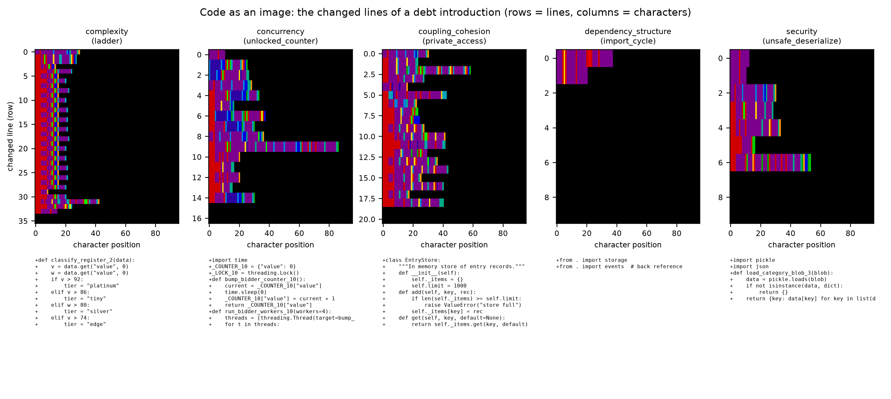
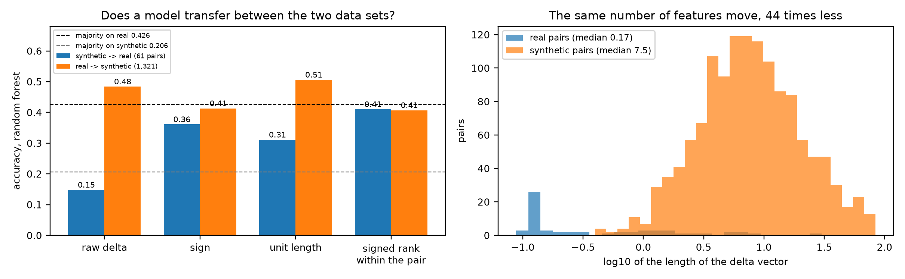
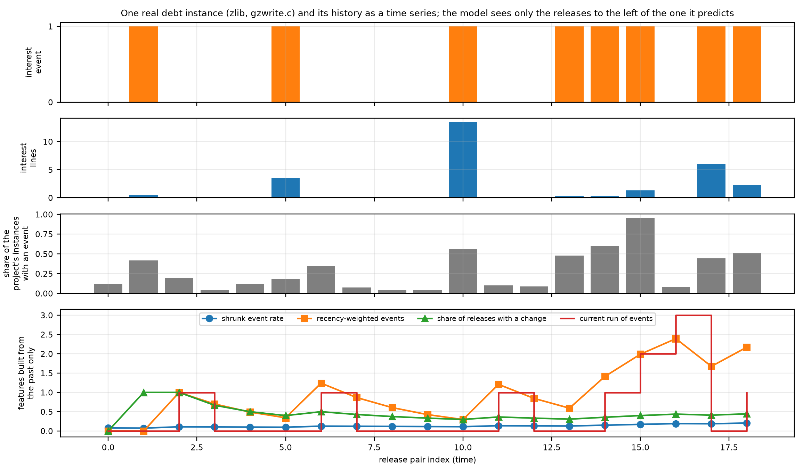
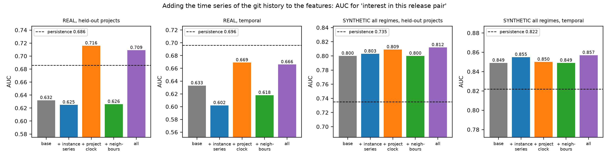
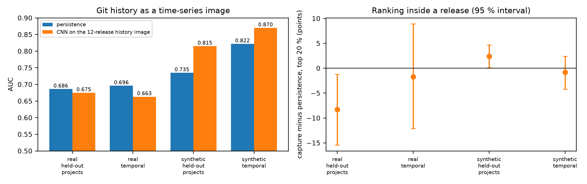
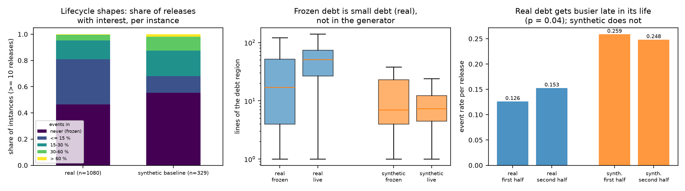
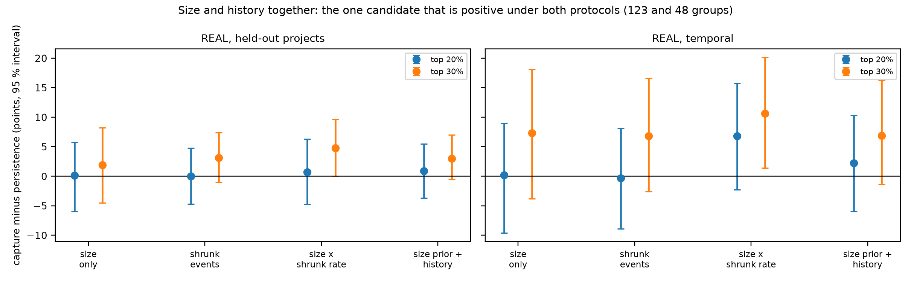

# Code as an image, history as a time series, and what the data really says

Written for: you (the project author), to decide what to claim and what to build next.

What was done: (1) the changed code of every debt introduction turned into an **image** and classified by a **CNN**; (2) the **git history treated as a time series**, its signals added to the feature space, and a CNN over a time-series image of the history; (3) a **sim-to-real** test: does a model trained on the synthetic benchmark work on your real data; (4) a search for **patterns** that differ between the real and the synthetic histories. Code in `code/`, numbers in `results/`, figures in `../../presentation/new_figures/`, re-run with `run_new.sh`.

Reminder of what the data are: the *real* data are the 61 clean/debt pairs and the git histories of 9 repositories; the *synthetic* data are the 150 generated projects of `../../synthetic_dataset/` (simulated histories, template code). The real results count; the synthetic ones show which methods work under known truth.

## 1. Summary

| # | Result | On the real data |
|---|---|---|
| 1 | **A CNN on the code image** is perfect on templates it has seen (0.97 random split, 0.98 held-out project) and poor on a new template: **0.56**, against **0.83** for the 133-feature random forest | trained on synthetic images, it gets **0.164** on the 61 real pairs (majority 0.426) |
| 2 | **Sim-to-real with the features**: a forest trained on the synthetic pairs gets **0.148** on the real pairs; the reverse (real -> synthetic) gets 0.48. The same *number* of features move in both (35 against 34), but the real change is **44 times smaller** (median length of the delta vector 0.17 against 7.5). Scale-free versions of the delta raise sim -> real to 0.31-0.41, still not above the majority | the synthetic benchmark cannot yet stand in for the real pairs |
| 3 | **Git history as time-series features** (events, gaps, runs, trend, recency, autocorrelation per instance; project activity; neighbours): on the real data **no gain** (AUC 0.625 against 0.632 without; capture -3.1 points against persistence, n.s.). On the synthetic data a small gain (capture +3.4 against +1.8 for the base features) | no |
| 4 | The **project clock** features raise the pooled AUC on the real data from 0.632 to **0.716** (held-out projects), but this is a *calibration across projects* (how busy a project is), not timing: capture inside a release does not change (-0.6), and under the temporal protocol the AUC is 0.669, below persistence (0.696) | AUC only |
| 5 | **A CNN on the history as a time-series image** (last 12 releases x 7 channels): works on the synthetic histories (AUC 0.815 against persistence 0.735; temporal 0.870 against 0.822), **fails on the real ones** (0.675 against 0.686; capture -8.3 (-15.4, -1.2) points) | no: it learns the generator's temporal structure |
| 6 | **Frozen debt is small debt**: in the real histories frozen instances have a median of 17 lines, live ones 51 (p = 1e-29); in the synthetic data there is no difference (7 and 7) | yes (a real pattern) |
| 7 | Real events are **more clumped in time** than the synthetic ones (17 % of the instances against 6 % significantly clumped), and real debt becomes **busier in the second half of its life** (event rate 0.126 -> 0.153, p = 0.044; synthetic 0.259 -> 0.248, p = 0.54) | yes (suggestive, p = 0.04) |
| 8 | **Size as a prior, history as the evidence** (a Bayesian score) does not beat the plain product **size x shrunk event rate**, which is the one candidate that is positive under both protocols (top 30 %: +4.8 (-0.0, +9.7) held-out projects, +10.6 (+1.4, +20.1) temporal) | borderline |

## 2. Code as an image, and a CNN

**The transformation.** For each debt introduction (the commit that adds the debt, parent -> child) the changed lines are drawn as an image: one row per changed line (up to 64, the file of the debt first), one column per character (up to 96); channel 0 is the character class (letter, digit, underscore, quote, bracket, operator, punctuation, space; scaled to 0..1), channel 1 is +1 for an added line and -1 for a removed line. 1,321 synthetic images and 61 real ones (from `td.patch`). `code/n1_images.py`.

**The CNN** (three convolution blocks, global mean and max pooling, 30 epochs, 2 seeds; `code/n2_cnn_code.py`).

| split | CNN on the image | 133 features, random forest | patch words, logistic regression |
|---|---|---|---|
| random split | 0.970 | 0.942 | 0.964 |
| held-out project | 0.977 | 0.960 | 0.979 |
| **held-out template** | **0.561** | **0.828** | 0.584 |
| real pairs, trained on all synthetic | **0.164** (Python 0.146, C/C++ 0.200) | 0.148 | - |

**What it means.** The image makes the *texture* of a template visible (a ladder of `elif` lines is a column of similar rows; `pickle.loads` is a short row), and the CNN reads it perfectly. That is exactly a template fingerprint, not debt: shown a template it has not seen, it falls to the level of the patch words (0.56-0.58), and the hand-made features, which describe *what the code does* (complexity, locks, calls), stay at 0.83. Shown real code it never predicts concurrency or security (the two commonest real types) and calls most of them dependency_structure. Turning code into an image does not add generalisation; it makes the fingerprint easier to learn. (A file-level graph image was already shown to be blind to 43 of 61 debts: `../INSIGHTS.md`, insight E.)

## 3. Sim-to-real: does the synthetic benchmark transfer?

A random forest trained on the 1,321 synthetic deltas predicts the 61 real pairs with **0.148**, below the majority (0.426), and puts nearly everything in dependency_structure. The reverse direction, trained on the 61 real pairs and tested on the synthetic ones, gets 0.484 (majority 0.206), and 0.625 with unit-length deltas and a logistic regression.

**Why.** The number of features that change is the same (35 real, 34 synthetic), but the median length of the delta vector is 0.17 for the real pairs and 7.5 for the synthetic ones: the real debt change is **44 times smaller** relative to the project (the synthetic debt is about 1.8 % of the lines of its project, the real one 0.086 %). A forest trained on large changes sees every real change as "almost nothing" and falls back to one class.

**Scale-free deltas** (only the direction of the change): sign 0.361, unit length 0.311, signed rank within the pair 0.410 (random forest). The best is close to the overall majority (0.426), and the C/C++ pairs (0.65-0.75) are at their own majority (0.70, 14 of 20 are security). So direction carries something, but not enough to beat guessing.

**What it means.** The dilution of the debt change (`../INSIGHTS.md`, insight B) is the main difference between the benchmark and the real project; it is not a detail. To make the synthetic data a proxy for the real pairs, the generator needs far smaller debt changes inside far larger code (or mixed commits with much more unrelated change).

## 4. Git history as a time series

**Features** (`code/n4a_prep_ts.py`), all computed from the releases before the one that is predicted: per instance (events so far, shrunk rate, events in the last 1, 3 and 5 releases, gap since the last event, mean and regularity of the gaps, current and longest run, trend, recency-weighted events, delay to the first event, lag-1 autocorrelation, share of releases with any change); project clock (activity of the previous release, mean of the last three, trend, share of the project's instances active in the last 1 and 3 releases); same-file neighbours (last 1 and 3 releases). Gradient boosting with the groups added one by one (`code/n4b_ts_models.py`).

- **Real data: the instance time series does not help** (AUC 0.625 against 0.632 without, held-out projects; 0.602 against 0.633, temporal). The base features already contain the events so far, the age and the size.
- **The project clock raises the AUC (0.716) but not the ranking.** AUC pools all releases and projects, so a feature that says "this project is busy" (the share of its instances that were active in the last three releases is the second most used feature) improves it. Inside one release every instance has the same clock value, so the order does not change (capture -0.6). This is the quantitative form of an earlier finding: the release clock is not predictable within a project, but projects differ in how busy they are. Under the temporal protocol, where the project is known, the gain disappears (AUC 0.669 against persistence 0.696).
- **Synthetic data:** the time series helps a little (capture +3.4 (+1.1, +5.9) against +1.8 for the base features under held-out projects; the recency-weighted events are the most used feature, 0.37), and not under the temporal protocol. Per regime (`results/n4c_regimes.txt`) the matching group helps only where the signal was built in and only slightly: AUC 0.843 -> 0.866 in `decay` (time series), 0.820 -> 0.827 in `contagion` (neighbours), and **not** in `ar_clock` (clock 0.801 -> 0.787). None of the capture differences is significant.

- **A CNN on the history image** (7 channels x 12 releases, 1-D convolutions; `code/n4d_seq_cnn.py`) reproduces the same split: AUC 0.815 against persistence 0.735 (synthetic, held-out projects) and 0.870 against 0.822 (temporal), but 0.675 against 0.686 and 0.663 against 0.696 on the real data, with capture -8.3 (-15.4, -1.2) points under held-out projects. The network learns the temporal structure that the generator has; the real histories do not have more of it than persistence and size already capture.

## 5. Patterns in the histories (real against synthetic)

`code/n5_patterns.py`, instances with at least 10 releases (real 1,080, synthetic baseline 329).

1. **Frozen debt is small debt.** Real frozen instances (never an event): median 17 lines; live: 51; Mann-Whitney p = 1.2e-29. Synthetic: 7 and 7 (p = 0.76). This is the same fact as "size predicts interest" (AUC 0.66) seen from the other side: tiny functions are never touched.
2. **Real events cluster in time.** Wald-Wolfowitz runs test per instance (given its number of events): mean z = -0.65 and 17 % of the instances significantly clumped (z < -1.64), against -0.33 and 6 % in the synthetic baseline. Both data sets are overdispersed across instances (variance/binomial 2.3 and 2.2), so heterogeneity alone is matched; the within-instance clumping is stronger in the real histories (a stronger release clock, as in the ICC 0.28 against 0.12).
3. **Real debt heats up late.** Event rate in the first half of an instance's life 0.126, in the second half 0.153 (Wilcoxon p = 0.044, 579 instances with an event); synthetic 0.259 and 0.248. Suggestive only (p = 0.04, one test among several), and it could also be the instances that were introduced during a period of development.
4. **Shapes.** By share of releases with interest (instances with at least 10 releases): real 46.4 % never, 34.4 % up to 15 %, 14.4 % 15-30 %, 4.4 % 30-60 %, 0.5 % above 60 %; synthetic baseline 55.3 %, 12.8 %, 19.5 %, 10.6 %, 1.8 %. The synthetic baseline has a **fatter hot tail** (12.5 % of the instances with an event in more than 30 % of the releases, against 4.8 % real) and a thinner middle. The only real instances with an event in every release are **one function**, zlib `inflate_table` (171 lines), counted three times because three smells (complex method, long method, many parameters) flag it; so the "always-on core function" is a single function, not a group. Events are spread over the whole life in both (events span 0.63 of the life; 0.61 expected for uniform placement), so there is no "active window".

**Independence caveat.** A real instance is a (function, smell) pair, so one function can appear several times and the real instances are not independent; the p-values of this section (frozen against live size, early against late) are therefore optimistic. The size difference is large enough (17 against 51 lines) to survive; the late-heating p = 0.044 should not.

## 6. Size and history together

On the real histories size alone ties persistence (`../synthetic/INSIGHTS_SYNTHETIC.md`, section 3). Two ways to combine size and history (`code/n6_size_prior.py`):
- *the product* size x shrunk event rate;
- *a prior from the size* (logistic regression on log size, fitted on the training projects) updated with the instance's events: (events + 3 p0) / (releases + 3).

Capture in the top 30 %, difference to persistence with size ties (95 % interval): the product **+4.8 (-0.0, +9.7)** (held-out projects, 123 groups) and **+10.6 (+1.4, +20.1)** (temporal, 48 groups); the prior with history +3.0 (-0.6, +7.0) and +6.9 (-1.4, +16.2); size alone +1.9 and +7.3. In the top 20 % none is clear. AUC by the age of the instance (held-out projects): at age 0-1 size is exactly as good as persistence (0.694 and 0.694), at age 5 or more persistence is a little better (0.706 against 0.665). So size is the cold-start signal and history takes over slowly. The product is the best candidate and the only one that is positive under both protocols, with interval ends at or near zero.

## 7. The insights (what is new, in order of confidence)

1. **An image does not make debt visible, it makes the generator's template visible.** Held-out template 0.56 against 0.83 for the features, 0.16 on real code. (Strong: 1,321 pairs, three independent representations agree.)
2. **The benchmark and the real pairs differ by a factor of 44 in the size of the debt change**, not in how many features move. This is why nothing trained on the benchmark works on the real pairs, and why a single snapshot is easy in the benchmark and hopeless in real code. (Strong: measured directly.)
3. **The release clock is calibration, not timing.** It improves a pooled AUC by 0.08 because projects differ in how busy they are, and does nothing for ranking inside a release or for prediction of the next release inside a known project. (Strong for the real data: AUC, capture and the temporal protocol agree.)
4. **The history as a time series adds nothing that the event count, the age and the size do not already contain**, on the real data, with features and with a CNN. It adds a little on synthetic data that were built with temporal structure. (Strong for "no gain on real", with the caveat of 9 repositories.)
5. **Size is the cold-start signal, and frozen debt is small debt.** (Strong: p = 1e-29, AUC 0.66, size as good as persistence at age 0-1.)
6. **Real debt is burstier and heats up later in life than the generator's; the generator's very hot tail is too fat.** (Moderate; the late heating is p = 0.04.)
7. **Size x history is the only combination that is above persistence under both protocols**, borderline. (Weak to moderate.)

## 8. Caveats
- 9 real repositories (123 held-out groups, 48 temporal groups), 61 real pairs. Intervals on the real ranking differences are wide (+-5 to +-10 points).
- The CNNs are small, trained on CPU for 14-30 epochs with 2 seeds, with no tuning; a better architecture or pretraining could change the code-image result, but not the scale mismatch (section 3) and not the template effect (a held-out template stays 0.56 for every representation).
- The time-series features use release counts as the unit; finer units (commits) might carry more.
- The held-out-project split for the synthetic time-series models is 15 folds, for the sequence CNN 5 folds; the real data use leave-one-repository-out (9 folds) for the feature models and 5 folds for the CNN.
- Pattern 3 (late heating) is one test of several; treat it as a lead.

## 9. What to do next
1. **Fix the generator where it disagrees with the real data**: a size/exposure effect (edit rate growing with the size of the function), debt changes 40 times smaller relative to the project, stronger release clock and event clustering, a thinner hot tail. Then rebuild and repeat sections 3-5. This is the condition for the benchmark to be a proxy.
2. **Build the real Level 1 data at a larger scale** by mining natural pairs (a commit and its parent) with the same extraction, since the benchmark cannot yet stand in for them (`../INSIGHTS.md`, section 3).
3. **For ranking, keep to size and the event rate**; test the product size x shrunk rate on more real repositories before claiming it.
4. **Drop the clock and the history-image CNN for ranking**; keep the clock as a project-level calibration if a pooled probability is needed.

## 10. Late additions (see `../../INSIGHTS_ALL.txt` for the complete list)
- **Model dependence of the real classifier** (`code/n8_logistic_check.py`): leave one project out on the 61 real pairs: random forest on the raw delta 0.459 (boltons 0.00, the other 37 pairs 0.757); logistic regression on the direction of the delta (unit length) 0.639-0.672 (boltons 0.92, the other 37 pairs 0.46-0.51). The direction-only transform was found while exploring these pairs, so the number is optimistic. Figure `06_combined/C4_level1_model_dependence_and_pooling.png`.
- **Pooling real and synthetic** (`code/n7_combined.py`): Level 2, AUC on the held-out real data 0.626 (real only), 0.631 (real + synthetic), 0.675 (synthetic only), persistence 0.686; Level 1, adding the 1,321 synthetic pairs lowers the real leave-one-project-out accuracy (random forest 0.443 -> 0.393, logistic 0.656 -> 0.295). Figures `06_combined/C2`, `C4`.
- **Panel of 20 metrics on real, synthetic and pooled rows**: 7 agree within 25 %, 9 are similar, 4 differ (size effect, frozen/live size, hot tail, release clock). Figure `06_combined/C1_panel_real_vs_synthetic.png`.

## 11. CodeBERT embeddings (the J8 test, `code/n9_*.py`)
Frozen `microsoft/codebert-base` embeddings of the added and removed lines (windows of 510 tokens, averaged), logistic regression on top. **Criterion fixed in advance not met**: held-out-template accuracy 0.618 (features 0.828, code-image CNN 0.561, patch words 0.584), real pairs 0.295 (mean-pooled) / 0.344 ([CLS]) against a majority of 0.426. On templates seen in training it is as good as everything else (0.969 random, 0.977 held-out project, 0.949 temporal). Per template it is complementary to the features (path_traversal 0.88 against 0.05; eval_input 0.08 against 0.95); an average of the two gives 0.822, no gain. Figure `05_new_experiments/E7_codebert_embeddings.png`. Not tried: fine-tuning, a code model covering C/C++, a learned fusion.

## 12. Reproduce
`run_new.sh` lists the scripts in order and the Python each needs (a Python with scikit-learn, pandas, lizard for the data work; one with torch for the CNNs; matplotlib for the figures). The CNN of the code images takes about 45 minutes on two CPU threads.
