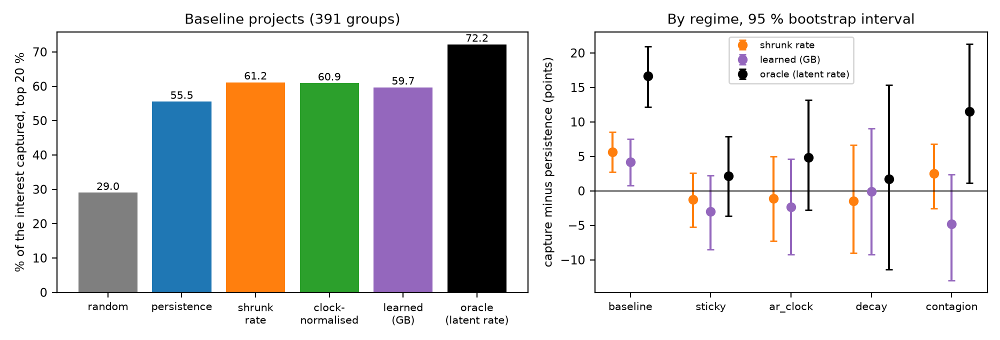
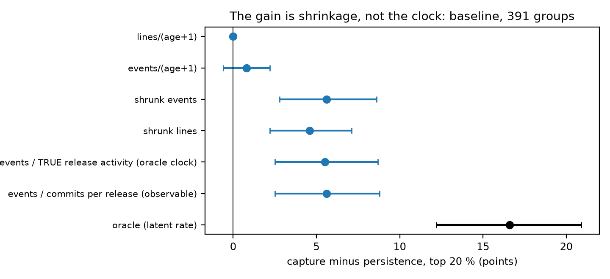
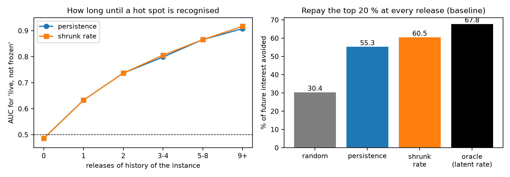
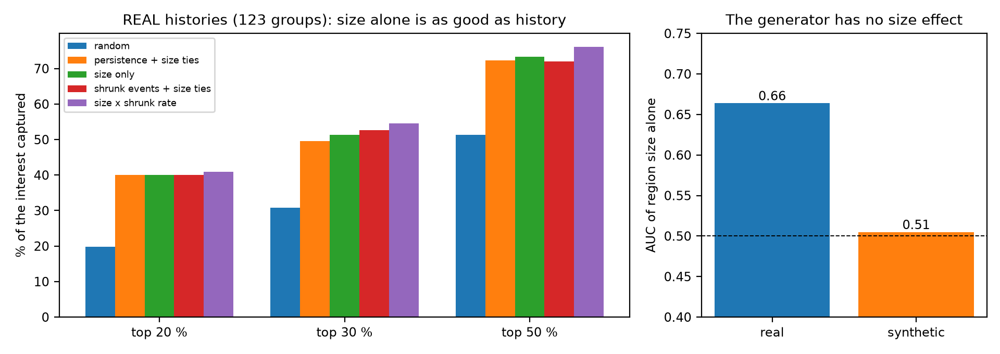
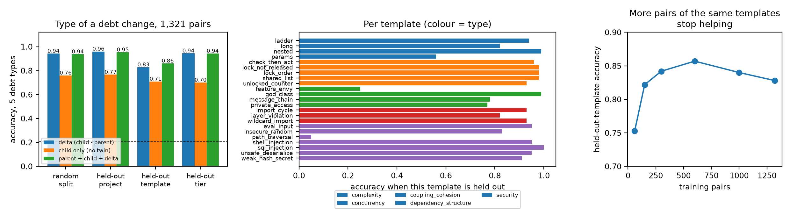
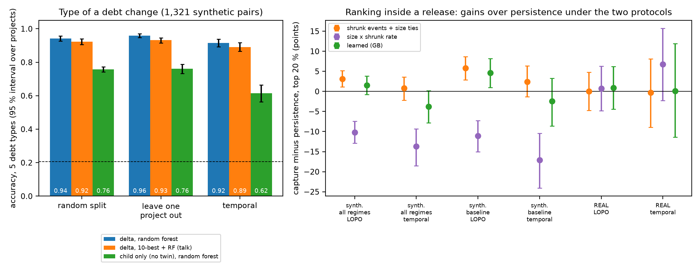

# Analysis of the synthetic benchmark: what held, what did not, what it says about the real project

Written for: you (the project author), to decide what to claim, what to change in the talk, and what to build next.

Data: `../../synthetic_dataset/` (150 generated projects, 1,321 debt instances, 11,927 instance-releases, 1,806 interest events, 1,321 commit pairs). Code in `code/`, numbers in `results/`, figures in `figs/`, all re-run by `../run_synthetic.sh`.

## 0. How to read this: what the synthetic data can prove

I built the generator so that the patterns of `../INSIGHTS.md` hold in its baseline projects (frozen debt, persistent hot spots, flat memory, avoided debt, a random release clock). Therefore:

- A result that **recovers a pattern built into the generator** only confirms the generator. These are marked **(by construction)** below and are not evidence about developers.
- What the data **can** do legitimately: (1) test methods against the exact truth (the latent rate of every instance is known, so the ceiling of any history-based ranking is exact); (2) show **which method survives in which regime**, because 60 of the projects break one pattern each; (3) let me **develop a method on the synthetic data and confirm it on the real histories**. Where a result is tested on both, the real one is the one that counts.
- It also exposed **what the generator lacks** (section 3), which is a result about the real data.

## 1. Summary

| # | Finding | By construction? | On the real data |
|---|---|---|---|
| 1 | Shrinking the event rate (events + 2) / (releases + 2/base rate) beats "interest already paid" by **+5.6 points** in the top 20 % (95 % interval +2.8 to +8.6, 391 groups), and by +5.1 points of the future interest avoided | partly (rates are gamma distributed, exposure differs) | **not confirmed**: +0.0 (-4.7, +4.8) in the top 20 %, +3.1 (-1.1, +7.3) in the top 30 %, -0.2 in the top 50 %, with alpha fixed in advance |
| 2 | The whole gain is the shrinkage. Raw event counts instead of lines: +0.8 (n.s.); shrunk counts +5.6; shrunk lines +4.6 | - | not applicable |
| 3 | **Normalising by the activity of each release does not help**, even with the generator's exact clock: +5.5 against +5.6 without. Idea refuted | - | not tested (refuted with an upper bound) |
| 4 | A learned model (gradient boosting on shrunk rate, recency, same-file neighbours, previous release activity, size, age) is no better than the shrunk rate (+4.2 against +5.6); in the four counter-regimes nothing differs from persistence significantly | - | learned model also no better (-2.3, n.s.) |
| 5 | The exact ceiling is far above every method: in the baseline, oracle 72.2 against persistence 55.5 and shrunk rate 61.2. The remaining 11 points need the latent rate itself, which history only reveals slowly (finding 6) | exact for the generator | the real ceiling is unknown |
| 6 | **How long to recognise a hot spot**: the AUC of the history for "live, not frozen" is 0.49 at age 0, 0.63 after 1 release, 0.74 after 2, 0.80 after 3-4, 0.87 after 5-8, 0.91 after 9 or more | (by construction) | small projects (5-6 releases) live in the cold start |
| 7 | **Size predicts interest in the real data and not in the synthetic data**: AUC of region size alone 0.66 (real) against 0.51 (synthetic); Spearman with the event rate 0.31 against 0.05. On the real histories, "largest region first" captures 40.1 % in the top 20 %, the same as persistence (40.1 % with the same tie-break), and 73.4 % in the top 50 % | a **gap of the generator** | **a result about the real project** (section 3) |
| 8 | The type of a debt change from the 133 features: random split 0.94, held-out project 0.96, held-out tier 0.95, **held-out template 0.83** (majority 0.21) | by construction (clean templates) | much higher than the real 61 pairs (0.79-0.89): not comparable |
| 9 | **The twin is worth 0.18 accuracy**: the delta (child - parent) gives 0.94 / 0.96 against 0.76 / 0.77 for the child alone | partly | consistent with the real finding |
| 10 | Patch words alone: 0.96 (random) and 0.98 (held-out project) but **0.58 for a held-out template**: the words identify the template, not the debt | by construction | consistent with the real finding |
| 11 | More pairs of the same templates stop helping: held-out-template accuracy 0.75 (60 pairs), 0.82 (150), 0.84 (300), 0.86 (600), 0.84 (1,000), 0.83 (1,321). **Template diversity, not pair count, is the limit** | by construction | important for the real data collection |
| 12 | Per template, held-out: three fail: path_traversal 0.05, feature_envy 0.25, many-parameters 0.56 (the other 20 are 0.77-1.00) | by construction | shows that semantic generalisation needs an analogue in training |
| 13 | A drift-scaled delta (divided by the project's own release-to-release change) does not help: 0.955 against 0.960 (held-out project), 0.851 against 0.828 (held-out template) | - | also failed on the real pairs |
| 14 | Mixed commits (other edits in the same commit) cost 3.6 points: 0.947 against 0.983 held-out project | by construction | drift hurts a little |
| 16 | **Protocols**: the delta classifier is 0.915 (temporal) and 0.959 (leave one project out); the snapshot loses 14 points under temporal; ranking gains over persistence depend on the protocol (section 5) | partly | ranking: no protocol shows a significant gain in the top 20 % |
| 15 | The release-level total of interest cannot be predicted from the previous release (R² 0.03-0.06 baseline, 0.15 in `ar_clock`) | by construction | consistent with the real R² < 0 |

## 2. Ranking debt inside a release (Level 2)

**Baseline projects (391 groups, top 20 %).** Random 29.0, persistence 55.5, shrunk rate 61.2, clock-normalised 60.9, learned 59.7, oracle (the generator's latent rate) 72.2. The shrunk rate is +5.6 (+2.8, +8.6) above persistence, the oracle +16.6 (+12.2, +20.9). The ranking benefit is real in the sense of "better than persistence under this generator", and the gap to the oracle shows how much room remains.

**Regimes.** In `sticky`, `ar_clock`, `decay` and `contagion` no method differs from persistence significantly (groups: 111, 75, 50, 64; all intervals include 0). Two things are visible:
- *The regime-specific signals did not help.* Recency does not help in `decay` (+0.6, n.s.), and the same-file neighbours do not help in `contagion`: persistence is already close to the oracle there (decay: 74.6 against 76.3; contagion: 60.2 against 71.7). A pattern that exists in the data is not automatically a useful feature once persistence is in the model.
- *The release clock cannot help ranking inside a release*: it multiplies every instance of the release alike. It matters for budgeting (finding 15), not for the order.

**Why the shrunk rate wins here (and the clock does not).** Persistence divides the lines paid by the releases of exposure, so one event in one release ranks as high as 6 events in 20. Shrinking pulls short histories toward the base rate. The decomposition shows that this is all: counts against lines changes nothing, and normalising by the release activity (the generator's own clock, the commits per release, or the lines added) changes nothing either, because the instances of a release were exposed to almost the same releases, so the normaliser cancels.

**Time to recognise a hot spot, and the repayment policy.** In the baseline, half of the instances are live and half frozen. After 5-8 releases of history the AUC for telling them apart is 0.87; after 1 release it is 0.63. A project with 5-6 releases (the small tier) is therefore mostly in the cold start, where history cannot rank and a prior has to. If a team repays the top 20 % of the live instances at every release, the shrunk rate avoids 60.5 % of the future interest, persistence 55.3 %, random 30.4 %, the oracle 67.8 %.

## 3. What this showed about the real project

**Size is as good as history on the real histories, and the generator has no size effect.** This is the most important result of the exercise, and it came from comparing the two datasets.
- Real data, 123 groups, top 20 %: random 19.8, persistence 38.3 (ties at random) or 40.1 (ties by size), **size alone 40.1**, shrunk rate + size ties 40.1, size x shrunk rate 40.9. Top 30 %: 47.6 / 49.6 / 51.4 / 52.7 / 54.5 (persistence with random ties, persistence with size ties, size alone, shrunk rate, size x shrunk rate). Top 50 %: 67.0 / 72.3 / 73.4 / 72.0 / 76.1. None of the differences between size alone and persistence is significant; size alone beats persistence with random ties by +6.4 (+0.2, +12.6) in the top 50 %.
- The AUC of the region size alone for "interest in this release pair" is **0.66 on the real data and 0.51 on the synthetic data**: larger functions are edited more often (exposure), and my generator does not model it.
- **Correction of `../INSIGHTS.md` (insight I, and the statement that persistence is the strongest baseline).** The "+8 points at the top 30 and 50 %" of the hotness scores compared a score with a size tie-break against persistence with random ties. With the same tie-break the differences are +5.4 (-0.6, +11.7) at the top 30 % and +2.9 (-0.8, +6.9) at the top 50 %: not significant. Part of what looked like the signal of the history is size.
- What it means for the talk: "the ranking ties persistence" is true, but persistence is not the story. A rule that uses no history at all ties it. The honest statement is that the history adds little beyond the size of the region on these nine repositories, and the best combination (size x shrunk rate) is borderline (+4.9 (+0.1, +10.0) in the top 30 %).

**What to do with it.** Add an exposure effect to the generator (a regime where the edit rate grows with the size of the function) and rebuild; test size x history on more real repositories before claiming the combination.

## 4. The type of a debt change (Level 1)

- **The twin pays.** Using the delta (child - parent) instead of the child alone raises accuracy from 0.76 to 0.94 (random split), 0.77 to 0.96 (held-out project) and 0.71 to 0.83 (held-out template). Adding the parent and the child to the delta does not help (0.94, 0.95, 0.86).
- **The split decides the number.** A random split or a held-out project says 0.94-0.96; a held-out template says 0.83. The real 61 pairs had 0.43 for held-out projects, because 24 of them were in one project; the synthetic data removes that, so held-out project is easy, and the question that remains is whether the *edit pattern* generalises.
- **Three templates are not recognised from the others** of their type: `path_traversal` 0.05 (the only security template that is not a call to a dangerous function; bandit does not flag it either), `feature_envy` 0.25, `params` 0.56. The rest are 0.77-1.00. A held-out template is only predictable if another template of the type looks like it.
- **More data of the same kind does not fix this.** The held-out-template accuracy rises from 0.75 to 0.86 between 60 and 600 pairs and then stays at 0.83-0.86. The next gain has to come from more kinds of edit (new templates, LLM-written variants, natural fixes), as concluded for the real data in `../INSIGHTS.md` (insight D).
- **Patch words are a fingerprint.** 0.96 (random) and 0.98 (held-out project) against 0.58 (held-out template).
- **Host invariance (partly).** The cosine similarity of the standardised deltas of pure commits in different projects is 0.49 for the same template, 0.31 for the same type and a different template, and -0.03 for a different type: a template leaves a recognisable signature in other hosts, but the normalised features move with the host (it is not 1.00 as for the same patch in older versions of the same project).
- **Only dependency changes show in the file graph.** A graph feature changes in 89 % of the dependency-structure pairs and in 1-2 % of the others: a file-level graph or image cannot see the other four types (the real data said the same for 69 % of the pairs).
- **Drift and mixed commits.** Mixed commits lower accuracy by 3.6 points (0.947 against 0.983). Scaling by the project's drift changes nothing (0.955 against 0.960). By tier (held-out project): S 0.92, M 0.96, L 0.98, X 1.00; I did not test why larger projects are easier.

## 5. The two protocols of the talk: leave-one-project-out and temporal

Definitions (as in the talk): **leave-one-project-out** holds one whole project out (150 folds synthetic, 9 real); **temporal** trains on the earlier part of every project's history (first 60 % of its releases, or of its pairs by commit order) and tests on the later part (the projects are seen). Code `code/s1_protocols.py`, `code/s2_protocols.py`; numbers `results/s1_protocols.*`, `results/s2_protocols.txt`.

**Type of a debt change (accuracy, 5 types, majority 0.21; 95 % intervals over projects in the csv)**

| input, model | random split | leave one project out | temporal | LOPO minus temporal |
|---|---|---|---|---|
| delta, random forest | 0.942 | 0.959 | 0.915 | +4.4 points |
| delta, 10-best + RF (the talk's model) | 0.924 | 0.932 | 0.892 | +4.0 |
| child only (no twin), random forest | 0.758 | 0.762 | 0.615 | **+14.7** |
| child only, 10-best + RF | 0.657 | 0.694 | 0.590 | +10.4 |

- **The delta generalises under both protocols**: 0.89-0.96 against a majority of 0.21. Temporal is the harder one (0.915 against 0.959 for the random forest; 0.892 against 0.932 for the talk's model), by 4 points.
- **The single snapshot does not**: the child alone loses 14 points when it has to predict *later* pairs (0.76 -> 0.62), but not when it predicts other projects (0.76). The project drifts, and a snapshot learned early goes stale; the difference to the parent does not. This is the temporal side of the "twin cancels the host" result (partly by construction: the drift is the generator's release growth).
- For comparison the real 61 pairs gave 0.79 / 0.43 (random / leave one project out); there is no temporal protocol for the 61 pairs (they have no release order).

**Ranking inside a release (capture in the top 20 %; difference to persistence with size ties, points, 95 % interval)**

| score | synth. LOPO (all) | synth. temporal (all) | synth. LOPO (baseline) | synth. temporal (baseline) | **real LOPO** | **real temporal** |
|---|---|---|---|---|---|---|
| groups | 691 | 249 | 391 | 132 | 123 | 48 |
| persistence (capture, %) | 57.9 | 66.4 | 55.3 | 66.4 | 40.1 | 38.2 |
| shrunk events | +3.1 (+1.1, +5.2) | +0.8 (-2.2, +3.6) | +5.8 (+2.9, +8.7) | +2.4 (-1.3, +6.4) | +0.0 (-4.7, +4.8) | -0.3 (-8.9, +8.1) |
| size only | -25.0 | -30.5 | -24.0 | -34.7 | +0.1 (-5.9, +5.8) | +0.5 (-9.3, +9.3) |
| size x shrunk rate | -10.2 | -13.7 | -11.1 | -17.1 | +0.7 (-4.8, +6.3) | **+6.8 (-2.3, +15.7)** |
| learned (GB) | +1.5 (-0.8, +3.8) | -3.8 (-7.8, +0.2) | +4.6 (+1.0, +8.2) | -2.4 (-8.6, +3.3) | +0.9 (-4.4, +6.2) | +0.1 (-11.4, +11.9) |
| oracle (latent rate) | +11.7 | 0.0 (-4.7, +4.4) | +16.8 | +3.3 (-3.5, +10.5) | - | - |
| learned AUC, 'interest in this release pair' | 0.798 | 0.842 | 0.771 | 0.810 | 0.637 | 0.640 |

In the top 30 % (details in `results/s2_protocols.txt`): the size x shrunk rate on the real histories is +4.9 (+0.1, +9.9) under leave-one-project-out and **+10.6 (+1.5, +20.1) under the temporal protocol**; size alone +1.8 and +7.0 (both n.s.).

**What generalises across the two protocols, and what does not**
1. **Holds in both:** the value of the twin (delta against snapshot); the delta's accuracy (0.89-0.96); on the real histories, the combination of size and history is the only score that is above persistence under both protocols in the top 30 % (borderline intervals, 48 temporal groups only).
2. **Does not hold in both:**
   - The shrunk-rate gain of the synthetic data (+5.8 baseline) exists only under leave-one-project-out; under temporal it is +2.4 (n.s.). After 60 % of the history persistence has already learned the hot spots: in the synthetic temporal test it equals the oracle (66.4 against 66.4), so there is no headroom left. The headroom is in the early releases (cold start), which the temporal test excludes.
   - The learned model gains under leave-one-project-out (synthetic baseline +4.6) and not under temporal (-2.4).
   - On the real histories no ranking method beats persistence significantly in the top 20 % under either protocol.
3. **The accuracy gap between the protocols is small for ranking and for the delta, large for the snapshot**: the AUC of the learned model is 0.637 (leave one project out) against 0.640 (temporal) on the real data, 0.798 against 0.842 on the synthetic; the capture of persistence in the top 20 % is 40.1 against 38.2 (real) and 57.9 against 66.4 (synthetic).

**So, is it generalised?** The *type* classifier on the delta is (both protocols above 0.89). The *ranking* methods are not: their gains over persistence depend on the protocol (cold start included or not) and do not appear on the real data at all, except the size x history combination at the larger budget. Report both protocols for every claim, as above.

## 6. Caveats
- Everything marked "by construction" reflects the generator. The synthetic Level 1 accuracies (0.94-0.96) are far above the real ones because the synthetic templates are cleanly separable; do not compare them.
- Section 2 uses 691 groups from 150 projects, of which 391 baseline; the regime results rest on 50-111 groups each and are underpowered for differences below about 8 points.
- The ranking scores were evaluated on realised interest of the same instances that the history came from, as in the real analysis; the learned model is trained on other projects.
- The size result (section 3) comes from 9 real repositories (123 groups); the interval of every difference to persistence includes 0 except the top-50 % comparison with persistence at random ties.
- No LLM-written code is in the synthetic data; the motivation of the project (AI-generated debt) is not tested.

## 7. What to do next (in order)
1. **Fix the talk's baseline story**: size alone ties persistence; say so, and use "size x history" as the real candidate (with its borderline interval).
2. **Add an exposure effect to the generator** and rebuild, then repeat sections 2 and 3; this is the one place where the benchmark disagrees with the real data in a way that matters for the ranking.
3. **Collect template diversity, not pairs** for Level 1: new kinds of edits (LLM-written, mined natural fixes), reported per template as in section 4.
4. **Plan for the cold start**: with fewer than 5 releases of history the ranking has to come from size and type; measure how much of the real interest is predictable from size and region type in young projects.
5. **Do not chase the release clock or the regime-specific signals** (recency, neighbours) for ranking inside a release: they did not help even where they exist.

## 8. Reproduce
`../run_synthetic.sh` (set `VENV` to a Python with scikit-learn, pandas, lizard; `FIG` to one with matplotlib). The pair experiments take about 20 minutes (the learning curve). The real-data parts need `../../interest_exp/data` and the output of `../code/l2_enrichment.py`.
